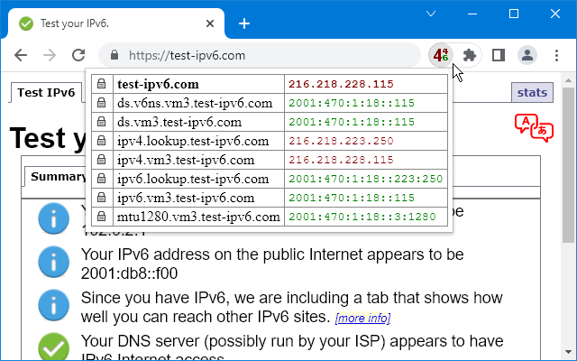
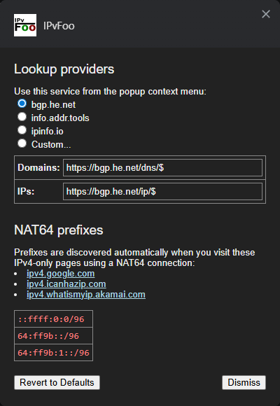

**IPvFoo** is a Chrome/Firefox extension that adds an icon to indicate whether the current page was fetched using IPv4 or IPv6. When you click the icon, a pop-up appears, listing the IP address for each domain that served the page elements.

Connection information is captured privately using the webRequest API, without creating additional network traffic.  Optional IPinfo lookups are described below.

## Screenshots

## Add to Chrome
https://chrome.google.com/webstore/detail/ipvfoo/ecanpcehffngcegjmadlcijfolapggal

<picture></picture>
<picture></picture>
<picture></picture>

## Add to Firefox
https://addons.mozilla.org/addon/ipvfoo/  

<picture></picture>
<picture></picture>
<picture></picture>

To use IPvFoo with Firefox's default search engine, uncheck **Settings > Search > Show search terms in the address bar on results pages**

## Add to Edge
https://microsoftedge.microsoft.com/addons/detail/ipvfoo/dphnkggpaicipkljebciobedeiaiofod  

<picture></picture>
<picture></picture>
<picture></picture>

*(You can also run the Chrome version on Edge, as they are identical.)*

## Safari?

IPvFoo cannot be [ported to Safari](https://github.com/pmarks-net/ipvfoo/issues/39) because the `webRequest` API does not report IP addresses.  In theory, a Safari extension could do its own DNS lookups, but this would create additional network traffic, and may disagree with the browser's address selection.

## Running IPvFoo unpacked from git

IPvFoo shares a common codebase for Chrome and Firefox, but `manifest.json` is browser specific.

Firefox shows this error when running the Chrome version:

> There was an error during the temporary add-on installation.  
> background.service_worker is currently disabled. Add background.scripts.

Chrome shows this error when running the Firefox version:

> 'background.scripts' requires manifest version of 2 or lower.  
> 'page_action' requires manifest version of 2 or lower.

The `use_*_manifest.sh.bat` scripts in the [manifest](src/manifest/) directory may be used to switch between versions.

## Optional IPinfo lookups

To display organization, ASN, and country information, enter an [IPinfo Lite](https://ipinfo.io/developers/lite-api) token in Options, enable online lookup, and click Save.  This feature is disabled by default.  Test connection checks `8.8.8.8` with the entered token without saving it.

When enabled, opening the popup sends eligible destination IP addresses to IPinfo over HTTPS.  It does not send page URLs, domain names, or page content.  IPinfo can also see the public IP address of your connection.  Private and special-purpose addresses are filtered locally, and online lookup is disabled in incognito windows.

The token and a bounded 24-hour result cache are stored locally, not in browser sync.  Options provides controls to clear the token and cache.  Country is an IP database estimate, and may not identify the physical location of an anycast server.  Country flags are [bundled SVGs](src/flags/README.md), with no external image requests.

The popup sizes itself to its content.  Long IPv6 addresses can be expanded using the same omission icon as domains; copying and context-menu lookups retain the full address.

## Tests

Open [tests/iputil_test.html](tests/iputil_test.html) in a browser to run the original address tests.  See [tests/README.md](tests/README.md) for the IPinfo unit and browser tests.  Node.js and Playwright are development-only dependencies; the extension and existing Makefile build do not require them.

   
Donate: https://liberapay.com/pmarks
